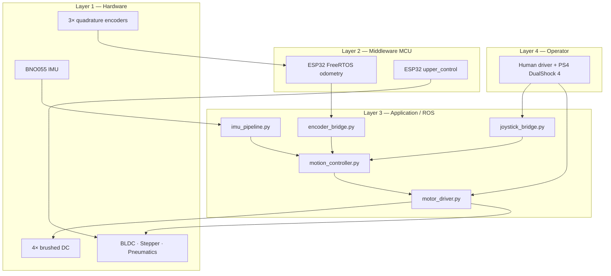
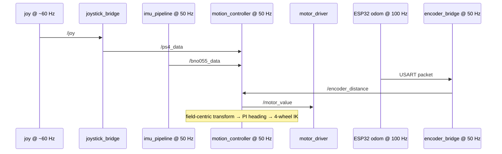
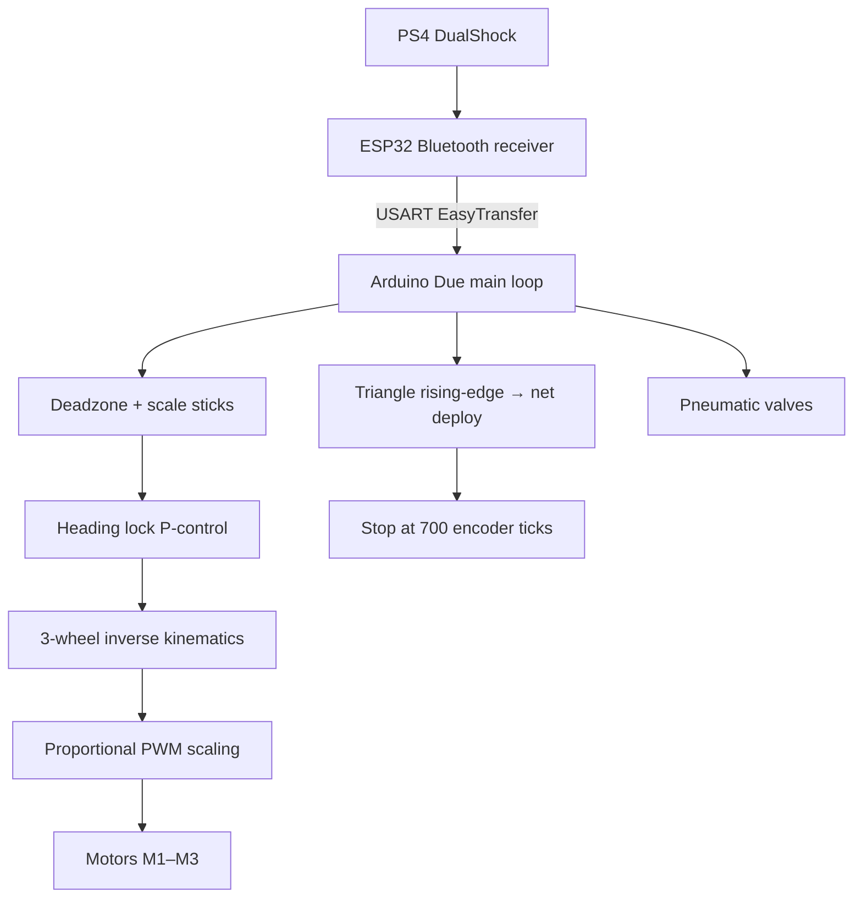
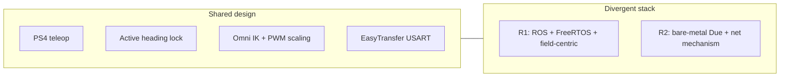

# System Architecture

This document describes the layered software/firmware architecture for both robots and the communication contracts between components.

---

## 1. Design principles

| Principle | How it is applied |
|---|---|
| Separation of concerns | Perception, planning/control, and actuation are independent ROS nodes (R1) or modular functions (R2) |
| Shared autonomy | Driver commands velocity + heading target; firmware/ROS closes the heading loop |
| Deterministic I/O | Encoder sampling is FreeRTOS-pinned (R1) or bare-metal polled (R2) |
| Fail-safe actuators | `motor_driver.py` zeros all outputs on ROS shutdown |

---

## 2. R1 Offense — layered stack



### 2.1 ROS topic contract

| Topic | Type | Publisher | Subscriber | Payload |
|---|---|---|---|---|
| `/joy` | `sensor_msgs/Joy` | `joy` node | `joystick_bridge`, `motor_driver` | Raw axes/buttons |
| `/ps4_data` | `geometry_msgs/Twist` | `joystick_bridge` | `motion_controller` | `linear.x/y` velocity, `angular.z` heading target |
| `/bno055_data` | `std_msgs/Float32` | `imu_pipeline` | `motion_controller` | Filtered yaw (degrees) |
| `/encoder_distance` | `std_msgs/Float32MultiArray` | `encoder_bridge` | `motion_controller` | `[x_cm, y_cm]` |
| `/motor_value` | `std_msgs/Int32MultiArray` | `motion_controller` | `motor_driver` | 4 signed wheel speeds |
| `/encoder` | `std_msgs/Float32MultiArray` | `motion_controller` | (odometry consumers) | Corrected world pose |

### 2.2 Timing



### 2.3 USART — ESP32 odometry → Pi

Binary EasyTransfer struct from firmware (`esp32_odometry_rtos.ino`):

```c
struct SEND_READING {
    double currentDist_x;  // world-frame X (cm)
    double currentDist_y;  // world-frame Y (cm)
    double angle;          // heading (rad)
};
```

The ROS `encoder_bridge.py` also documents an ASCII fallback form `X:<int>, Y:<int>` for debug/serial parsing at 115200 baud on `/dev/serial0`.

### 2.4 Serial — Upper control commands

| Command | Example | Effect |
|---|---|---|
| `T <us>` | `T 1500` | ESC throttle (1000–2000 µs) |
| `A <deg>` | `A 30.5` | Stepper target angle |
| `D` | `D` | Pneumatic dribble sequence |

---

## 3. R2 Defense — bare-metal architecture



### 3.1 EasyTransfer PS4 packet

```c
struct PS4_DATA {
    int  x;        // left stick X (±100)
    int  y;        // left stick Y
    int  buttons;  // packed button flags
    float angle;   // gyro heading for lock
};
```

### 3.2 Why bare-metal on R2?

R2’s control path is strictly sequential: *receive → decide → actuate*. There is no concurrent sensor fusion pipeline that benefits from an RTOS. Bare-metal on the Due yields lower latency and simpler timing for match-critical motor response.

---

## 4. Cross-robot comparison



---

## Related documents

- [CONTROL_SYSTEMS.md](CONTROL_SYSTEMS.md) — PID, filters, IK equations  
- [HARDWARE.md](HARDWARE.md) — sensors, actuators, pin maps  
- [../README.md](../README.md) — abstract and quick start  
