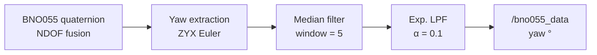
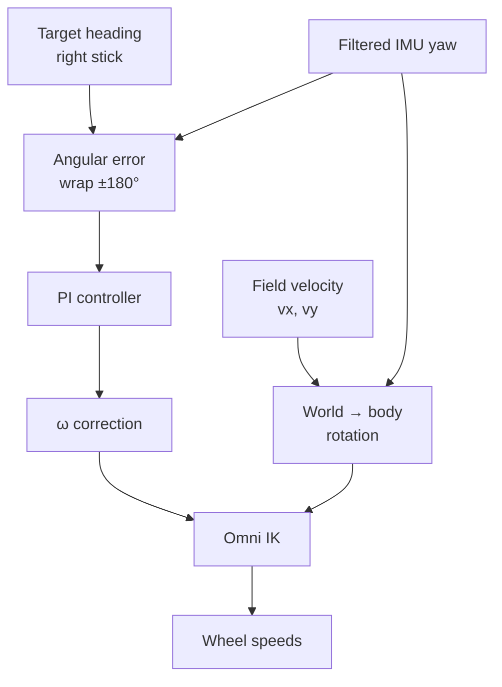
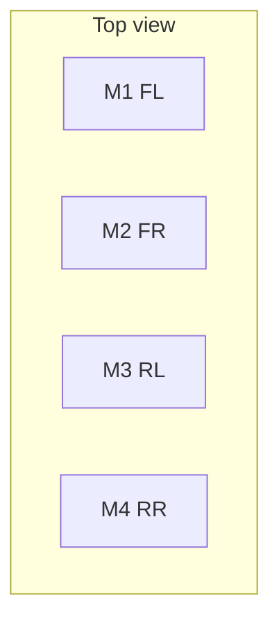
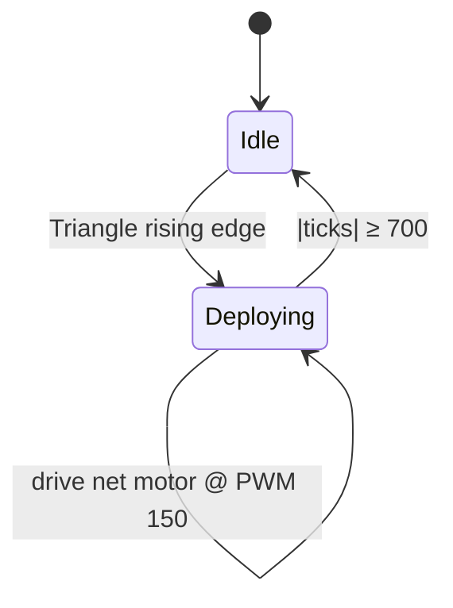

# Control Systems

Mathematical and algorithmic description of the shared-autonomy controllers used on R1 and R2.

---

## 1. IMU signal chain (R1)

### 1.1 Quaternion → yaw

\[
\psi = \mathrm{atan2}\bigl(2(wz + xy),\; 1 - 2(y^2 + z^2)\bigr)
\]

Output is converted to degrees in \([-180^\circ, 180^\circ]\).

### 1.2 Median filter

Rejects impulsive I2C glitches. Window size \(N = 5\).

### 1.3 Exponential low-pass

\[
\hat{\psi}_k = \alpha\,\psi^{\mathrm{med}}_k + (1-\alpha)\,\hat{\psi}_{k-1}, \quad \alpha = 0.1
\]

At 50 Hz this trades ~10-sample lag for smoothness acceptable for heading lock.

### 1.4 Fault recovery

On `OSError` (I2C brown-out), the node drops the sensor handle and retries connection every 1 s without restarting the ROS graph.

---

## 2. Active Heading Lock

### 2.1 Error wrap

\[
e = \bigl((\psi_{\mathrm{des}} - \psi) + 180\bigr) \bmod 360 - 180
\]

### 2.2 PI (R1)

\[
\omega = K_p e + K_i \int e\,dt
\]

| Gain | Value | Role |
|---|---|---|
| \(K_p\) | 3.0 | Primary stiffness |
| \(K_i\) | 0.05 | Steady-state drift rejection |
| \(K_d\) | 0.0 | Disabled (avoids amplifying IMU noise) |
| Integral clamp | \(\pm 50\) | Anti-windup |

Loop rate: **50 Hz** (`motion_controller.py`).

### 2.3 P-only (R2)

On the Due, \(\omega = K_p e\) with \(K_p = 1.5\), using the gyro angle delivered in the EasyTransfer struct.

---

## 3. Field-centric transform (R1)

Driver sticks define motion in the **world / field frame**. Before IK they are rotated into the **body frame**:

\[
\begin{bmatrix} v_x^b \\ v_y^b \end{bmatrix}
=
\begin{bmatrix}
\cos\psi & \sin\psi \\
-\sin\psi & \cos\psi
\end{bmatrix}
\begin{bmatrix} v_x^w \\ v_y^w \end{bmatrix}
\]

Effect: “push stick forward” always means “up-field”, independent of chassis yaw.

---

## 4. Inverse kinematics

### 4.1 R1 — 4-wheel omni (45°)

Geometric constants:

\[
K = \frac{1}{2\sqrt{2}} \approx 0.3536, \quad
L_R = \frac{0.09}{0.075} = 1.2
\]

\[
\begin{aligned}
\omega_1 &= K(-v_x + v_y) + L_R\,\omega \\
\omega_2 &= K(-v_x - v_y) + L_R\,\omega \\
\omega_3 &= K( v_x - v_y) + L_R\,\omega \\
\omega_4 &= K( v_x + v_y) + L_R\,\omega
\end{aligned}
\]

### 4.2 R2 — 3-wheel omni (120°)

\[
\begin{aligned}
\omega_1 &= -\tfrac{2}{3}v_x &&+ \tfrac{\omega}{3} \\
\omega_2 &= \tfrac{1}{3}v_x + \tfrac{v_y}{\sqrt{3}} &&+ \tfrac{\omega}{3} \\
\omega_3 &= \tfrac{1}{3}v_x - \tfrac{v_y}{\sqrt{3}} &&+ \tfrac{\omega}{3}
\end{aligned}
\]

### 4.3 PWM saturation

If \(\max|\omega_i| > \mathrm{PWM_{max}}\), all channels are scaled by the same factor so direction is preserved:

\[
\omega_i \leftarrow \omega_i \cdot \frac{\mathrm{PWM_{max}}}{\max_j |\omega_j|}
\]

---

## 5. Encoder odometry (R1 ESP32)

Three passive wheels: \(X_U\), \(X_D\), \(Y\).

### Heading from differential X

\[
\Delta\theta = \frac{(\Delta x_D - \Delta x_U)\, d_{\mathrm{pulse}}}{2\, R_{\mathrm{enc}}}
\]

with \(d_{\mathrm{pulse}} = 18.84 / 10000\) cm/pulse and \(R_{\mathrm{enc}} = 30.3\) cm.

### World-frame integration

\[
\begin{aligned}
X_a &= X_b\cos\theta - Y_b\sin\theta \\
Y_a &= X_b\sin\theta + Y_b\cos\theta
\end{aligned}
\]

Task period: **10 ms (100 Hz)** on FreeRTOS Core 0.

---

## 6. Net deployment (R2)

Rising-edge detection (`triangle && !trianglePrev`) prevents re-trigger while the button is held.

---

## 7. Upper mechanism sequences (R1)

| Subsystem | Control law / sequence |
|---|---|
| BLDC shooter | ESC calibration in `setup()`; then open-loop µs throttle |
| Stepper aim | Closed-loop to target °; 8800 ticks = 23°; deadband ±0.2° |
| Pneumatic dribbler | Timed extend → hold → retract on command `D` |

---

## Related documents

- [ARCHITECTURE.md](ARCHITECTURE.md)  
- [HARDWARE.md](HARDWARE.md)  
