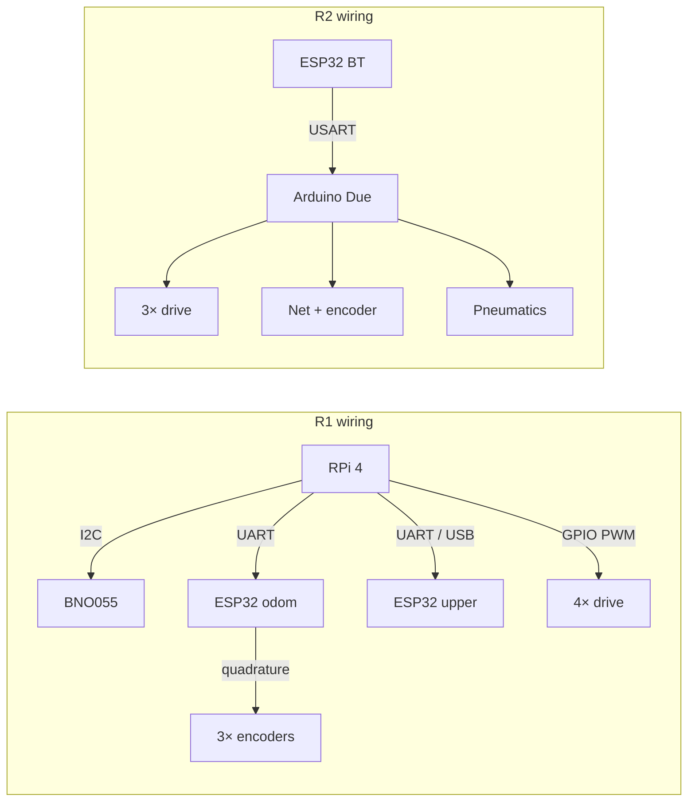

# Hardware Reference

Bill-of-materials style map of compute, sensing, and actuation for both robots.

---

## 1. R1 — Offense

### 1.1 Compute & sensing

| Component | Spec / interface | Role |
|---|---|---|
| Raspberry Pi 4 (4 GB) | ROS Noetic, USB/BT, I2C, UART | High-level control |
| Bosch BNO055 | I2C `0x28`, NDOF quaternion | Heading for field-centric + lock |
| ESP32 DevKit (odometry) | FreeRTOS, USART @ 115200 | 3× encoder world pose |
| ESP32 DevKit (upper) | Serial command parser | Shooter / aim / dribbler |
| PS4 DualShock 4 | Bluetooth → `joy` node | Teleoperation |

### 1.2 Drive & mechanisms

| Actuator | Drive method | Notes |
|---|---|---|
| 4× brushed DC + omni wheels | pigpio PWM + DIR GPIO | Wheel radius 0.075 m |
| BLDC shooter | ESC, 50 Hz PWM 1000–2000 µs | Calibrated on boot |
| Stepper (aim) | Step/Dir + encoder feedback | 8800 ticks ↔ 23° |
| Pneumatic dribbler | Solenoid valves (4-ch) | Double-acting cylinders |

### 1.3 Drive motor GPIO (BCM)

| Motor | PWM pin | DIR pin |
|---|---|---|
| M1 front-left | 21 | 20 |
| M2 front-right | 16 | 12 |
| M3 rear-left | 13 | 6 |
| M4 rear-right | 19 | 26 |

> Note: pneumatic/dribbler pins in `motor_driver.py` overlap the M4 set depending on board revision — verify against the physical harness before powering both subsystems on one Pi.

### 1.4 Actuator GPIO (BCM)

| Function | Pin |
|---|---|
| Pneumatic valve A | 19 |
| Pneumatic supply PWM | 26 |
| Shooter relay FWD | 23 |
| Shooter relay REV | 24 |

### 1.5 ESP32 odometry encoder pins

| Encoder | Pins |
|---|---|
| X upper (`encoderXU`) | 12, 14 |
| X lower (`encoderXD`) | 17, 16 |
| Y (`encoderY`) | 19, 18 |

### 1.6 ESP32 upper-control pins

| Function | Pin |
|---|---|
| Stepper STEP / DIR | 19 / 21 |
| Encoder A / B | 22 / 23 |
| ESC signal | 18 |
| Pneumatic A1 / A2 | 14 / 27 |
| Pneumatic B1 / B2 | 26 / 25 |

### 1.7 Mechanical constants

| Constant | Value |
|---|---|
| Wheel radius | 0.075 m |
| Robot contact radius | 0.2675 m |
| Half-diagonal / wheel | \(L_R = 1.2\) |
| Odometry wheel circumference | 18.84 cm |
| Pulses / revolution | 10 000 |
| X-encoder half-baseline | 30.3 cm |

---

## 2. R2 — Defense

### 2.1 Compute & sensing

| Component | Spec / interface | Role |
|---|---|---|
| Arduino Due | Bare-metal C++ | Full motion + net |
| ESP32 DevKit | PS4 Bluetooth → USART EasyTransfer | Wireless input |
| ADXRS (or equivalent gyro) | Angle in EasyTransfer struct | Heading lock |
| Secondary ESP32 (optional) | Serial3 odometry | Pose stream |

### 2.2 Drive & mechanisms

| Actuator | Pins / method | Notes |
|---|---|---|
| M1 | PWM 8, DIR 9 | Front |
| M2 | PWM 13, DIR 12 | Rear |
| M3 | PWM 11, DIR 10 | Rear |
| Net motor | PWM 54, DIR 55 | Encoder on 56/57 |
| Fan / blower | PWM 25, DIR 23 | Defensive air |
| Pneumatics | 52 (extend), 53 (retract) | Two-valve solenoid |

### 2.3 Net travel

| Parameter | Value |
|---|---|
| Target ticks | 700 |
| Deploy PWM | 150 |
| Trigger | Triangle rising edge |

---

## 3. Cabling overview

---

## 4. Safety notes

1. Always run `sudo pigpiod` before launching `motor_driver.py`.
2. Zero motors on node crash — confirmed via `rospy.on_shutdown` hook.
3. ESC must complete calibration before match start (`upper_control` `setup()`).
4. Confirm pin conflicts on shared GPIO banks when co-locating pneumatics and M4.

---

## Related documents

- [ARCHITECTURE.md](ARCHITECTURE.md)  
- [CONTROL_SYSTEMS.md](CONTROL_SYSTEMS.md)  
